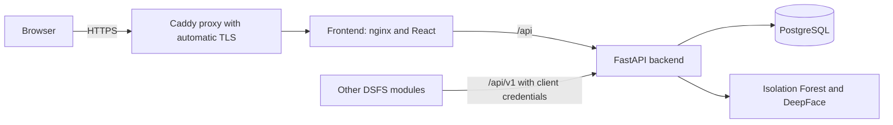

# RBAC Central Auth for the Digital School Feeding System

A role-based access control platform that works as the **central login and authorization service** for the
Digital School Feeding System (DSFS). It combines:

- **Two-step sign-in**: password, then Face ID (with liveness check) or an email one-time code
- **Role-based access with scopes**: roles grant permissions, scopes limit them to a school, department,
  organisation or the user's own records. Enforced on the server, deny by default
- **Isolation Forest anomaly detection** on every session, with SHAP explanations, an alert review workflow
  and a rule-based hybrid layer
- **An integration API** (`/api/v1`) so other modules (attendance, payments, logistics, ...) can validate
  users, ask for permission decisions and report activity
- **An administrator dashboard** (React) for users, roles, sessions, alerts, audit logs and integrations



For the integration API see **[docs/INTEGRATION_GUIDE.md](docs/INTEGRATION_GUIDE.md)**.

## Roles

| Role | Scope | Purpose |
|---|---|---|
| Administrator | global | Everything, including roles, users and integrations |
| Manager | department | Read-only dashboard and users for their department |
| Standard User | own | Own sessions only |
| Programme Administrator | global | Programme-wide monitoring, fraud review, reporting |
| School Administrator | school | Beneficiaries, attendance and SMS for one school |
| Teacher | school | Records attendance for their school |
| School Staff | school | Meal service and supply receiving |
| Finance Officer | global | Creates, approves and exports payments |
| Logistics Officer | global | Supply and delivery logistics |
| Supplier | organization | Only their own organisation's orders and deliveries |
| Parent/Guardian | own | Their linked children's attendance and payments |
| Auditor | global | Read-only across modules, with exports |

The full permission matrix is on the **Compare Roles** page of the dashboard.

## Quick start (local, Docker)

Requirements: Docker with Compose v2, and about 6 GB of free disk. The first build is slow (it downloads
TensorFlow and PyTorch).

```bash
git clone https://github.com/Nooman29/RBAC.git
cd RBAC
cp .env.example .env                                  # set POSTGRES_PASSWORD
cp backend/.env.docker.example backend/.env.docker    # set DATABASE_URL, SECRET_KEY, SMTP_*
docker compose up -d --build
```

On Windows PowerShell use `Copy-Item` instead of `cp`.

Create the roles and the first administrator (the database starts empty):

```bash
docker compose exec backend python -m scripts.seed_roles_and_permissions
docker compose exec backend python -m scripts.create_admin --username admin --email you@example.com
```

The seed prints "No users found" on a fresh database. Ignore it; `create_admin` makes the user.

Optional but recommended, to enable anomaly detection (scoring stays off until a model exists):

```bash
docker compose exec backend python -m scripts.seed_synthetic_data --create-users 8 --synthetic-users-only
docker compose exec backend python -m scripts.train_isolation_forest
docker compose exec backend python -m scripts.score_existing_sessions   # optional: score the seeded sessions so the dashboard has alerts
docker compose restart backend
```

Each script has `--help`. The first model is trained on synthetic sessions and can be retrained later.

Open http://127.0.0.1:5173 and sign in as the administrator. The first login walks you through
choosing Face ID or the email-code fallback.

| URL | What |
|---|---|
| http://127.0.0.1:5173 | Dashboard |
| http://127.0.0.1:8000/docs | Backend API docs (dashboard routes) |
| http://127.0.0.1:8000/api/v1/docs | Integration API docs (for other modules) |

## Configuration

`.env` (repository root, read by Docker Compose):

| Variable | Meaning |
|---|---|
| `POSTGRES_USER`, `POSTGRES_PASSWORD`, `POSTGRES_DB` | Database credentials. Password is required; use letters and numbers only |
| `DOMAIN` | Live deployment: your public domain |
| `COMPOSE_FILE` | Live deployment: set to `docker-compose.prod.yml` |

`backend/.env.docker` (read by the backend container):

| Variable | Default | Meaning |
|---|---|---|
| `DATABASE_URL` | required | e.g. `postgresql://user:pass@db:5432/rbac_db` |
| `SECRET_KEY` | required | Signs tokens and hashes service-client secrets. Changing it logs everyone out and invalidates client secrets |
| `ACCESS_TOKEN_EXPIRE_MINUTES` | 30 | Token lifetime. There is no refresh token; users sign in again after it expires |
| `SMTP_HOST`, `SMTP_PORT` | smtp.gmail.com, 587 | Mail server |
| `SMTP_USER`, `SMTP_PASSWORD` | required | Mail account (Gmail: use an App Password) |
| `FRONTEND_URL` | http://127.0.0.1:5173 | The URL users open. Used in email links and CORS |
| `CORS_EXTRA_ORIGINS` | empty | Other modules' frontends that call this API from a browser, comma-separated |
| `TRUSTED_PROXY_HOPS` | 1 | Proxies in front of the backend; the client address is read this many entries from the end of `X-Forwarded-For`. Set in the compose files (1 locally, 2 in production), not here |
| `OTP_EXPIRY_SECONDS`, `PENDING_TOKEN_EXPIRE_SECONDS` | 300 | One-time code and 2-step window |
| `BIOMETRIC_MODEL`, `BIOMETRIC_DETECTOR`, `BIOMETRIC_DISTANCE_THRESHOLD` | Facenet512, retinaface, 0.30 | Face recognition settings |

Email is not optional: it delivers one-time codes, account setup links and anomaly alerts.

## Hosting it live

### Option A: a server with your own domain (recommended)

You need:

- A Linux server (Ubuntu 22.04 or newer) with **at least 4 GB RAM** (the face and anomaly models are heavy;
  smaller machines commonly run out of memory) and 15 GB of disk. Student plans of the major cloud providers
  usually cover this; check what your GitHub Student Developer Pack currently offers
- A domain name with an **A record** pointing at the server's public IP
- Ports 22, 80 and 443 reachable

**1. Prepare the server**

```bash
curl -fsSL https://get.docker.com | sh
sudo ufw allow OpenSSH && sudo ufw allow 80/tcp && sudo ufw allow 443/tcp && sudo ufw enable
```

**2. Get the code and configure**

```bash
git clone https://github.com/Nooman29/RBAC.git && cd RBAC
cp .env.example .env
cp backend/.env.docker.example backend/.env.docker
openssl rand -hex 16     # use as POSTGRES_PASSWORD
openssl rand -hex 32     # use as SECRET_KEY
nano .env                # POSTGRES_PASSWORD, DOMAIN=rbac.example.com, COMPOSE_FILE=docker-compose.prod.yml
nano backend/.env.docker # DATABASE_URL (same password), SECRET_KEY, SMTP_*, FRONTEND_URL=https://rbac.example.com
```

**3. Start it** (the first build takes a while)

```bash
docker compose up -d --build   # the first build takes a while
docker compose ps              # wait until the backend shows (healthy); the first start can take 1-3 minutes
```

Because `COMPOSE_FILE` is set in `.env`, plain `docker compose` uses the production file.

**4. Bootstrap**

```bash
docker compose exec backend python -m scripts.seed_roles_and_permissions
docker compose exec backend python -m scripts.create_admin --username admin --email you@example.com
docker compose exec backend python -m scripts.seed_synthetic_data --create-users 8 --synthetic-users-only
docker compose exec backend python -m scripts.train_isolation_forest
docker compose restart backend
```

**5. Check it**

```bash
curl https://rbac.example.com/health
curl https://rbac.example.com/api/v1/health
```

Both should answer `status: ok`. Then open `https://rbac.example.com`. Face ID works because the site is on
HTTPS (browsers block camera access on plain HTTP). Caddy obtains and renews the certificate itself; if it
cannot, `docker compose logs caddy` will say why (usually the DNS record or a closed port).

### Option B: a temporary public demo from your own computer

For a quick demo without a server, run the local stack and expose it with a tunnel that provides HTTPS, for
example Cloudflare's:

```bash
cloudflared tunnel --url http://127.0.0.1:5173
```

It prints a public `https://...` address. Set `FRONTEND_URL` in `backend/.env.docker` to that address, run
`docker compose restart backend`, and share it. Free tunnel addresses usually change each time you start
them, and the demo only works while your computer is on.

## Running and maintaining it

```bash
docker compose logs -f backend          # follow backend logs
docker compose ps                       # status
git pull && docker compose up -d --build  # update to the latest version
```

Back up and restore the database:

```bash
docker compose exec -T db pg_dump -U rbac_user rbac_db > backup_$(date +%F).sql
docker compose exec -T db psql -U rbac_user rbac_db < backup_2026-10-20.sql
```

Data lives in Docker volumes (`pgdata`, `ml_models`, `deepface_weights`, and `caddy_data` for certificates).
`docker compose down` keeps them; `docker compose down -v` **deletes them**.

Register another module: sign in as Administrator, open **Integrations**, and create a service client. Or from
the terminal:

```bash
docker compose exec backend python -m scripts.create_service_client --name "Payments module" --scopes auth:introspect,authz:check
```

## Security checklist for a live deployment

- Use a long random `SECRET_KEY` and `POSTGRES_PASSWORD`; never commit `.env` or `backend/.env.docker`
- Keep the database and backend unpublished (the production file already does). Locally, port 8000 is
  published for scripts and the demo module, and a request sent straight to it can forge its client address,
  so do not expose it beyond your machine
- Keep the firewall limited to ports 22, 80 and 443; prefer SSH keys over passwords
- Give each module only the scopes it needs, and rotate a client secret if it leaks (Integrations page)
- Use a mail account dedicated to this system, with an app password
- Back up the database regularly and test a restore
- Keep Docker images and the server updated

## Testing

Unit tests run on an in-memory SQLite database (CI runs them on every pull request, with the frontend lint and
build). pytest is not part of the runtime image, so install it after each rebuild:

```bash
docker compose exec backend pip install pytest httpx
docker compose exec backend pytest -q
```

End-to-end checks against the running stack:

```bash
docker compose exec backend python -m scripts.verify_pass1     # roles, scopes, access decisions
docker compose exec backend python -m scripts.verify_pass2     # integration API
docker compose exec backend python -m scripts.verify_events    # events ingestion
docker compose exec backend python -m scripts.verify_audit     # component-level audit log
docker compose exec backend python -m scripts.verify_feedback  # administrator verdicts feeding detection
```

Each prints PASS or FAIL per check and exits non-zero on failure. They create temporary data and remove it.

Evaluation of the anomaly detector (results are kept in `docs/evaluation/`):

```bash
docker compose exec backend python -m scripts.model_experiments            # model comparison and tuning (isolated database)
docker compose exec backend python -m scripts.evaluate_realistic           # realistic attack rates and subtle insiders (isolated database)
docker compose exec backend python -m scripts.evaluate_retrain_stability   # threshold over weekly retrains (isolated database)
docker compose exec backend python -m scripts.evaluate_real_sessions       # false alarms on real sessions (read only)
```
`verify_pass2` fills the forgot-password rate limit; wait a minute (or restart the backend) before re-running.

## Troubleshooting

| Symptom | Likely cause and fix |
|---|---|
| Backend restarts in a loop | `docker compose logs backend`. Usually a missing value in `backend/.env.docker` or an unreachable database |
| Logs say `password authentication failed` | The password in `DATABASE_URL` (`backend/.env.docker`) differs from `POSTGRES_PASSWORD` (`.env`). If you changed `POSTGRES_PASSWORD` after the first start, the database volume still has the old one: either set it back, or reset with `docker compose down -v` (deletes all data) |
| Camera does not open / Face ID missing | The site is on plain HTTP. Use HTTPS (or http://127.0.0.1 on the same computer) |
| No emails or codes arrive | Check `SMTP_*`. Gmail needs an App Password |
| `Too many attempts` at login | Rate limit (about 20 sign-ins per minute per address); wait a minute |
| Caddy shows no certificate | DNS A record not pointing at the server yet, or ports 80/443 blocked |
| No anomaly alerts | No trained model yet: run `train_isolation_forest` and restart the backend |
| Old UI after an update | `docker compose build --no-cache frontend`, then hard refresh (Ctrl+Shift+R) |
| Everyone logged out after a change | `SECRET_KEY` was changed. Service-client secrets must be rotated too |

## Known limitations

- Rate limits are in memory per backend process and reset on restart
- Sessions have no refresh token; access tokens last 30 minutes
- The live anomaly threshold is an unsupervised percentile cutoff, not tuned on labelled data
- Offline activity cannot be reported by other modules once the user's token has expired